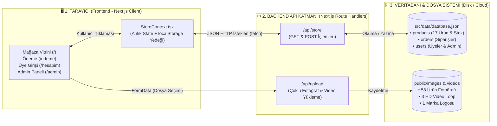

# 📊 VESPER BODY — Görsel Backend, Veritabanı ve Stok Mimarisi Rehberi

Bu rehber; **kullanıcı hesaplarının (`users`)**, **ürün ve beden stoklarının (`products` & `variants`)**, **siparişlerin (`orders`)** ve **medya dosyalarının (`images` & `videos`)** arka planda nasıl tutulduğunu görsel diyagramlarla anlatır.

## 1. Sistem Mimarisi (3 Katmanlı Akış)

## 2. Veritabanı Tabloları (`src/data/database.json`)

- **`products` Tablosu:** 17 ürünün tüm başlık, fiyat, kategori, `media` (fotoğraf/video yolları) ve `variants` (`XS`, `S`, `M`, `L`, `XL` beden stokları ve SKU kodları) verilerini tutar.
- **`orders` Tablosu:** Müşterilerin üyeliksiz veya üyeli verdiği tüm siparişleri, gizli kargo onayını, ödeme yöntemini ve kargo durumunu (`paid`, `preparing`, `shipped_discreet`, `delivered`, `cancelled`) tutar.
- **`users` Tablosu:** Kayıt olan müşterilerin (`fullName`, `email`, `phone`, `password`) ve mağaza yöneticisinin (`isAdmin: true`) hesap bilgilerini tutar.

