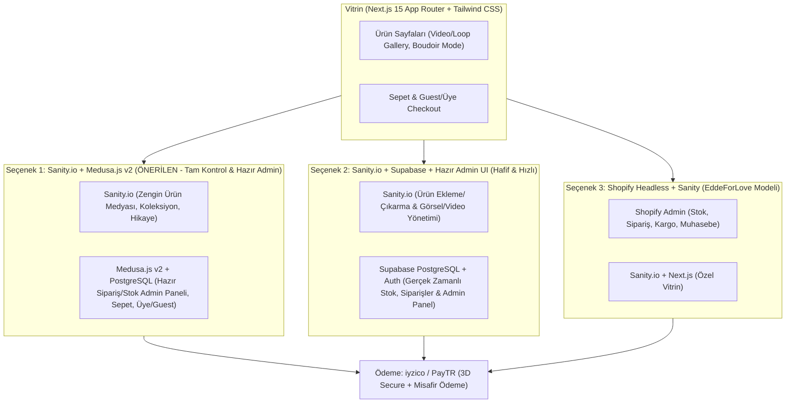

# Lüks & Fantezi İç Giyim E-Ticaret Platformu — Mimari, UX ve Taslak Önerisi (VESPER BODY)

> [!NOTE]
> Bu doküman; referans alınan **Edde for Love (`eddeforlove.com`)** analizini, müşteri gereksinimlerini (video/hareketli görsel odaklı ürün sayfaları, misafir/üye alışverişi, ödeme altyapısı, stok/sipariş yönetimi, "naughty touch" dokunuşları) ve **Sanity.io** merkezli teknoloji yığını (tech stack) değerlendirmesini içerir.

---

## 1. Referans Site Analizi: `eddeforlove.com`

**Edde for Love**, Türkiye pazarında (ve uluslararası gönderimde) Shopify altyapısını kullanan, "romantik, iddialı ve ulaşılabilir lüks" konumlandırmasına sahip bir iç giyim/fantezi giyim markasıdır.

### 1.1. Görsel Dil ve UX Karakteristiği
* **Tasarım Dili:** Karmaşadan uzak, ürün fotoğraflarını ve videolarını (tül, dantel, saten dokularını) öne çıkaran minimal ve temiz bir vitrin.
* **Trafik Kaynağı Odaklılık:** Link-in-bio (`utm_source=ig`) yapısından da görüldüğü üzere trafiğin **%85-%90'ı Instagram ve TikTok (mobil uygulama içi tarayıcılar)** üzerinden gelir. Bu nedenle masaüstünden ziyade **Mobile-First (Mobil Öncelikli)** dikey medya (9:16 ve 4:5) deneyimi kritiktir.
* **Kategori Kurgusu:**
  * Sütyen Takımları & Balkonetler (Özel koleksiyon isimleriyle: *Sofia, Layla, Mi Amor, Bride*)
  * Büstiyer & Korse Setleri
  * Bodysuit & Tulum
  * Jartiyer Takımları
  * Babydoll, Gecelik & Saten Elbiseler
  * Vücut Çorapları & Aksesuarlar
* **Operasyonel Güven Unsurları (Kritik Satın Alma Tetikleyicileri):**
  * **%100 Gizli Paketleme (Discreet Packaging):** İç giyim ve fantezi kategorisinde müşterinin en büyük çekincesi kargo görevlisinin veya üçüncü kişilerin paketin içeriğini anlamasıdır.
  * **Üyeliksiz (Guest) Hızlı Satın Alma:** Sosyal medyadan gelen dürtüsel (impulse) alıcı, form doldururken sıkılıp çıkmamalıdır.
  * **Hijyen Bandı & İade Şeffaflığı:** Şikayetvar verilerine göre iç giyim sektöründeki en büyük kriz noktası iade/değişim kuralları ve kampanya dönemlerindeki kargo süresi beklentisidir.

---

## 2. "Naughty Touch" (Zarif & Çekici Mikro-Deneyimler) Önerileri

Sitenin "çok afilli olmayan, standart ve kullanımı kolay bir e-ticaret sitesi" çizgisini bozmadan, ucuz veya kalitesiz bir "yetişkin sitesi" havasına kaçmadan (ve ödeme kuruluşu onaylarını tehlikeye atmadan) **Agent Provocateur / Honey Birdette** kalitesinde ekleyebileceğimiz **"Naughty Touch"** fikirleri:

1. **"Boudoir Mode" (Gündüz / Gece Modu Anahtarı):**
   * Sitenin sağ üst köşesinde standart bir "Dark Mode" ikonu yerine **"Daylight / After Dark (Gece Modu)"** geçişi.
   * *Daylight:* Krem, pudra, yumuşak şampanya ve antrasit tonları (`#FAF7F5` zemin).
   * *After Dark:* Derin kadife siyahı (`#0D0A0B`), bordo/yakut (`#6E0D25`) ve altın yansımalı (`#D4AF37`) bir ambiyans. Gece moduna geçildiğinde daha cesur/fantezi koleksiyonlar vitrinde üst sıraya çıkabilir.
2. **"Kumaşı Hisset / Yakından Bak" (Sensory Hover & Video Loop):**
   * Ürün kartlarının üzerine gelindiğinde (veya mobilde kaydırırken görünür olduğunda) sabit fotoğraf yerine **2-3 saniyelik ağır çekim (slow-motion) video/hareketli önizleme** otomatik başlar.
3. **"İpucu Bırak / Hediye Gönder" (Drop a Hint & Mystery Gift):**
   * Ürün sayfasında **"Partnerine İpucu Bırak (Drop a Hint)"** butonu: Beden seçilmiş haldeki ürün linkini tek tıkla WhatsApp veya e-posta üzerinden *"Bunu çok beğendim, bedenim M 🖤"* mesajıyla paylaşma özelliği.
   * Sepette **"Sır Olarak Gönder (Gizli Kutu + Kişisel Karanfil/Kart Notu)"** seçeneği.
4. **Cesaret / Stil Ölçer (Spice Level Indicator):**
   * Ürün detayında beden tablosunun yanında zarif bir gösterge: *Romantik (Romantic) • Çekici (Seductive) • Cesur (Daring / Naughty)*. Müşterinin aradığı tarza göre filtreleme yapmasını sağlar.

---

## 3. Teknik Meydan Okuma (Challenger Analizi): Sanity.io & Mimari Kararlar

> [!IMPORTANT]
> **Sanity.io Değerlendirmesi:** Ürün ekleme/çıkarma ve zengin medya (video/hareketli görsel) yönetimi için **Sanity.io harika bir seçimdir**, ANCAK tek başına bir e-ticaret motoru (stok kilitleme, sipariş durumu, iade, muhasebe) **değildir**.

### Neden Sadece Sanity.io Yetmez? (Risk Analizi)
1. **Stok Çakışması (Race Condition):** Sanity bir içerik yönetim sistemidir (CMS), ilişkisel bir ticaret veritabanı (ACID) değildir. Stokta son 1 adet kalan "S Beden Jartiyer Takımı"nı aynı anda 2 kişi satın alırsa, sadece Sanity kullanıldığında eksi stoğa düşme riski yüksektir.
2. **Sipariş ve Kargo Dashboard'u:** Sanity Studio içerik girmek için mükemmeldir ama *"Bekleyen Siparişler, Kargoya Verilenler, İptal/İade, Müşteri Adresi Yazdırma, Kargo Barkodu"* ekranlarını Sanity içinde sıfırdan kodlamak hem maliyetli hem de verimsizdir.
3. **GIF Tuzağı:** Ürün sayfalarında gerçek `.gif` formatı kullanmak mobil performansı öldürür (5 saniyelik bir GIF 15-25 MB yer kaplar ve görüntü kalitesi düşüktür). Bunun yerine **Sanity üzerinden yüklenen MP4/WebM videoların** `<video autoPlay muted loop playsInline>` etiketiyle **GIF gibi davranması** sağlanmalıdır (%90 daha küçük boyut, 4K keskinliğinde dantel/saten detayı).

---

## 4. Önerilen 3 Mimari Seçenek (Tech Stack Alternatifleri)

İhtiyacınız olan **"Sanity.io kolaylığında ürün yönetimi + Misafir/Üye Alışverişi + Ödeme Altyapısı + Hazır/Güvenilir Yönetici Dashboard'u"** için 3 somut yol haritası:

### Seçenek A (Önerilen): Next.js + Sanity.io (Vitrin & Ürün İçeriği) + Medusa.js v2 (Hazır E-Ticaret & Sipariş Dashboard'u)
* **Nasıl Çalışır?**
  * **Medusa.js v2**, açık kaynaklı (ücretsiz, aylık komisyonsuz) bir Shopify alternatifidir. Kutudan çıktığı anda **mükemmel bir Yönetici Dashboard'u (Siparişler, Stoklar, İadeler, İndirim Kuponları, Müşteriler, Misafir Alışverişi)** ile gelir.
  * **Sanity.io**, Medusa ile çift yönlü senkronize çalışır: Ürünlerin videolarını, "Naughty Touch" hikaye bloklarını, beden rehberlerini ve ana sayfa banner'larını Sanity Studio'dan yönetirsiniz.
* **Avantajı:** Sıfırdan sipariş/stok dashboard'u yazmak zorunda kalmazsınız; kurumsal düzeyde hazır admin paneliniz olur ve aylık Shopify kirası/komisyonu ödemezsiniz.

### Seçenek B (En Pratik / Tek Panel Odaklı): Next.js + Sanity.io (Ürünler) + Supabase (Stok, Sipariş, Auth) + Admin Panel
* **Nasıl Çalışır?**
  * Müşteriniz yeni ürünü, videoları, fiyatları ve başlangıç stoğunu doğrudan **Sanity Studio** üzerinden ekler.
  * Satın alma anında stok düşümü, üye/misafir sipariş kaydı ve **iyzico/PayTR** ödeme doğrulaması **Supabase (PostgreSQL)** üzerinde gerçekleşir.
  * Siparişleri ve güncel stokları görmek için Next.js içinde `/admin` rotasında (veya Sanity Studio içine gömülü özel bir sekmede) hazır bileşenlerle (Shadcn UI Data Tables) sipariş/kargo durum ekranı sunulur.
* **Avantajı:** Müşteriniz iki farklı panel görmek yerine tek bir panelden (Sanity + entegre Sipariş sekmesi) tüm mağazayı yönetir. Kurulumu ve barındırması (Vercel + Supabase + Sanity Free Tier) başlangıçta neredeyse **0 TL / ay** sabit maliyetlidir.

### Seçenek C: Payload CMS 3.0 Ecommerce Template (Sanity Alternatifi - Her Şey Tek Çatıda)
* Eğer Sanity.io şart değilse, Next.js'in içine doğrudan kurulan **Payload CMS 3.0**, hem Sanity gibi ürün/medya ekleme çıkarma hem de Sipariş/Stok tablolarını **tek bir veritabanında (PostgreSQL) ve tek bir hazır Admin Panelinde** birleştirir.

---

## 5. Sayfa ve Özellik Taslağı (Site Haritası & Fonksiyonlar)

### 5.1. Vitrin (Storefront)
1. **Ana Sayfa (Home):**
   * Üst Bilgi Çubuğu (Announcement Bar): *"🔒 %100 Gizli Paketleme | 1500 TL Üzeri Ücretsiz Kargo | Aynı Gün Gizli Gönderim"*
   * Tam Ekran Video Hero: Saten/dantel dokusunu gösteren sinematik loop video + *"After Dark"* koleksiyon çağrısı.
   * Hızlı Kategori Hikayeleri (Instagram Story formatında yuvarlak veya dikey kartlar: *Balkonet, Jartiyer, Babydoll, Bodysuit, Naughty*).
   * Öne Çıkan Ürünler Grid'i (Hover/Scroll anında video oynatan kartlar, hızlı beden seçip sepete ekleme).
2. **Kategori / Koleksiyon Sayfası (PLP):**
   * Beden (XS, S, M, L, XL), Renk (Siyah, Bordo, Ekru, Kırmızı), Stil/Cesaret Seviyesi ve Fiyat filtreleri.
3. **Ürün Detay Sayfası (PDP - En Kritik Sayfa):**
   * **Medya Galerisi:** Yüksek çözünürlüklü fotoğraflar + **GIF gibi otomatik dönen kısa detay videoları (MP4/WebM)**.
   * **Beden Seçici & Akıllı Beden Rehberi:** Sütyen/Alt beden eşleştirme tablosu, *"Mankenin üzerindeki beden: S (175cm, 85-60-90)"*.
   * **Naughty Touch Özellikleri:** *"Partnerine İpucu Bırak"* butonu, Stil/Cesaret derecesi.
   * **Güven Rozetleri:** Gizli Kargo kutusu görseli ve hijyen bandı açıklaması (açılır akordeon).
4. **Çekmece Sepet (Slide-over Cart Drawer):**
   * Sayfadan ayrılmadan sağdan açılan sepet.
   * *"Ücretsiz kargoya 250 TL kaldı"* ilerleme çubuğu (Sepet ortalamasını artırmak için çorap/aksesuar çapraz satışı - *Cross-sell*).
   * *"Gizli Hediye Notu Ekle"* kutucuğu.
5. **Ödeme Akışı (Guest & Member Checkout):**
   * **Üyeliksiz Devam Et (Varsayılan & Hızlı):** Sadece Ad-Soyad, Telefon, E-posta ve Teslimat Adresi ile 30 saniyede ödeme.
   * **Üye Girişi / Tek Tıkla Kayıt:** Google ile giriş veya SMS/E-posta OTP (şifresiz kod) ile giriş; geçmiş siparişleri ve kargo takibini görüntüleme.
   * **Ödeme Altyapısı:** **iyzico** veya **PayTR** (3D Secure kredi/banka kartı, taksit seçenekleri, Havale/EFT).

### 5.2. Yönetici Paneli (Admin & CMS Dashboard)
* **Ürün Yönetimi (Sanity Studio):**
  * Ürün adı, açıklama, fiyat, indirimli fiyat.
  * Varyant bazlı stok ve SKU (Örn: Siyah - S: 15 adet, Siyah - M: 8 adet).
  * Fotoğraf ve Video/Loop yükleme (sürükle-bırak).
* **Sipariş & Stok Kontrol Paneli:**
  * Gelen siparişlerin anlık listesi (*Ödeme Alındı → Hazırlanıyor → Kargoya Verildi → Teslim Edildi*).
  * Müşteri teslimat bilgileri ve gizli paketleme kargo fişi yazdırma.
  * Kritik stok uyarısı (Örn: 3 adetin altına düşen bedenler).

---

## 6. Ödeme Kuruluşu (iyzico / PayTR) ve Yasal Uyumluluk Uyarıları

> [!WARNING]
> **Ödeme Altyapısı Onay Kriteri:** Türkiye'deki sanal POS firmaları (iyzico, PayTR, Sipay vb.) "Adult / Yetişkin / Erotik Shop" kategorisindeki sitelere POS vermeyi reddedebilirken, **"Lüks İç Giyim, Gece Giyimi ve Fantezi Tekstil (Lingerie & Nightwear)"** kategorisindeki tekstil mağazalarına sorunsuz POS vermektedir.

* **Dikkat Edilmesi Gerekenler:**
  1. Sitede çıplaklık (sansürsüz göğüs ucu vb.) veya cinsel sağlık/oyuncak ürünleri yer almamalı, tekstil/iç giyim odaklı kalınmalıdır (tıpkı `eddeforlove.com` gibi).
  2. POS başvurusu yapılmadan önce sitede **Mesafeli Satış Sözleşmesi**, **İptal ve İade Koşulları (Hijyen İstisnası maddesiyle)**, **KVKK Aydınlatma Metni** ve **Hakkımızda/İletişim (Vergi Levhası bilgileri)** sayfaları hazır olmalıdır.

